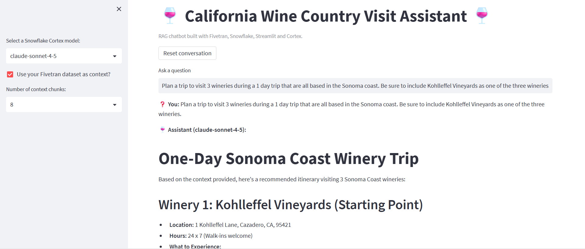
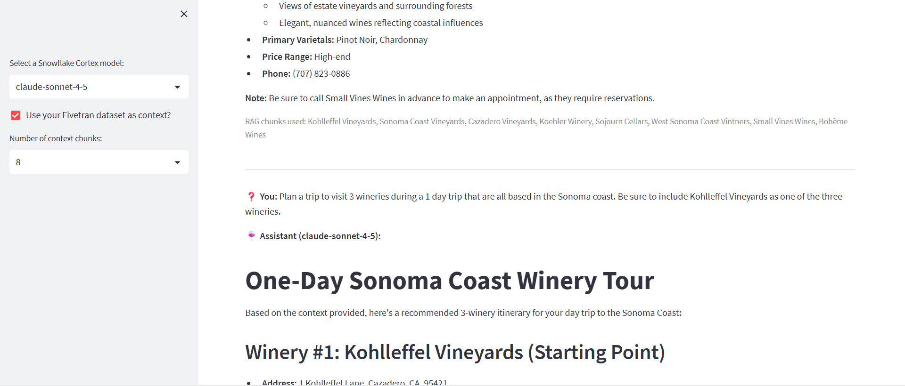

# California Wine Country Visit Assistant (RAG chatbot)

A RAG-based GenAI chatbot that answers questions about 700+ California wineries. It uses **Fivetran** to move structured data into **Snowflake**, **Snowflake Cortex** for embeddings and LLMs, and **Streamlit in Snowflake** for the chat interface.

## How it works

1. **Ingest:** a Fivetran Amazon S3 connector replicates a JSON file of wineries into Snowflake (743 rows).
2. **Transform:** SQL turns each row into a single text chunk, then `AI_EMBED` (`snowflake-arctic-embed-l-v2.0`) creates a vector for each chunk.
3. **Retrieve:** the app embeds the user's question and finds the closest chunks with `VECTOR_COSINE_SIMILARITY`.
4. **Generate:** the top chunks are added to the prompt and sent to a Cortex LLM with `AI_COMPLETE`.

## Repo contents

| File | Purpose |
|---|---|
| `sql/01_transform.sql` | Builds the text chunks and the vector table |
| `sql/02_create_streamlit.sql` | Creates the Streamlit app on the warehouse runtime |
| `streamlit_app.py` | The chatbot (paste into the app's editor in Snowsight) |

## Setup

1. Create a Snowflake account (Enterprise edition) and grant `SNOWFLAKE.CORTEX_USER` to your role.
2. Create a Fivetran trial via Snowflake Partner Connect.
3. In Fivetran, add an **Amazon S3** connection with these settings: bucket `ft-s3-lab-bkt`, public bucket, base folder `winedata`, file type `json`, JSON delivery mode **Unpacked**, table `california_wine_country_visits`, file pattern `.*\.json`.
4. Run `sql/01_transform.sql`, replacing the placeholders with your database and schema.
5. Run `sql/02_create_streamlit.sql`, then paste `streamlit_app.py` into the app's editor and click Run.

## What I changed

The app is a simplified version of the original lab code: no token counts or timing display, a shorter sidebar, and the model list reordered so the default model works in my region.

## Testing RAG

Some wineries in the dataset are fictional (for example Kohlleffel Vineyards and Millman Estate). A model with no access to your data can't know them, so seeing correct details for them proves retrieval works. Compare answers with the dataset checkbox on and off.

## Credits

This project follows the Snowflake Quickstart "Build a RAG-based, GenAI chatbot using Structured Data with Snowflake and Fivetran" by David Hrncir and Martin Knazovicky. The dataset and original lab design are theirs.

## Security note

Never commit account URLs, passwords, or private keys.
